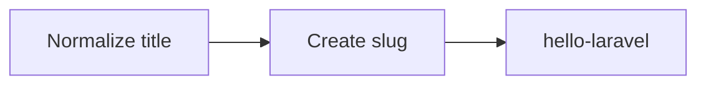
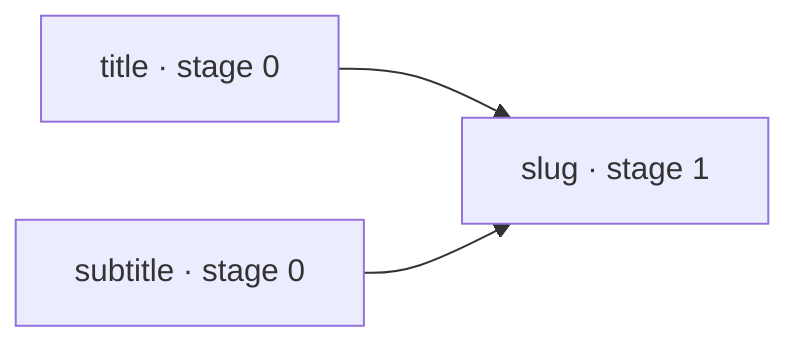

<p align="center">
  
</p>

<h1 align="center">Scarlett</h1>

<p align="center"><strong>Give your Laravel workflows a next step.</strong></p>
<p align="center">Typed PHP steps. Durable results. Progression driven by outcomes.</p>

<p align="center">
  <a href="https://github.com/brunocfalcao/scarlett/actions/workflows/tests.yml"></a>
  
  
  <a href="LICENSE"></a>
  <a href="#development-transparency"></a>
</p>

Scarlett runs multi-step workflows in your Laravel app. When one step finishes,
the next eligible steps are queued immediately—no dispatcher tick between them.



## Install

Requires **Laravel 13**, **PHP 8.4+** and a database. Use MySQL for concurrent
workloads; SQLite is suitable for local tests. PostgreSQL is not yet verified.

Add this entry to your application's `composer.json` repositories:

```json
{
    "type": "vcs",
    "url": "https://github.com/brunocfalcao/scarlett"
}
```

```sh
composer require brunocfalcao/scarlett:dev-main
php artisan migrate
```

## 1. Write your steps

Create these classes in `app/Workflows/Steps/`:

```php
<?php

declare(strict_types=1);

// NormalizeTitle.php
namespace App\Workflows\Steps;

use Scarlett\Step;

final class NormalizeTitle extends Step
{
    public function handle(string $title): string
    {
        return trim($title);
    }
}
```

```php
<?php

declare(strict_types=1);

// CreateSlug.php
namespace App\Workflows\Steps;

use Illuminate\Support\Str;
use Scarlett\Step;

final class CreateSlug extends Step
{
    public function handle(string $title): string
    {
        return Str::slug($title);
    }
}
```

## 2. Connect them

Call this from a Laravel service, controller or Artisan command:

```php
use App\Workflows\Steps\CreateSlug;
use App\Workflows\Steps\NormalizeTitle;
use Scarlett\Definition\Node;
use Scarlett\Definition\Workflow;
use Scarlett\Facades\Scarlett;
use Scarlett\Inputs\FromResult;

$workflow = Scarlett::start(new Workflow([
    new Node('title', NormalizeTitle::class, inputs: [
        'title' => '  Hello Laravel  ',
    ]),
    new Node('slug', CreateSlug::class, stage: 1, inputs: [
        'title' => new FromResult('title'),
    ]),
]));
```

`title` returns **Hello Laravel**. Scarlett saves it, then constructs `slug` with
that result. `slug` returns **hello-laravel**. You keep `$workflow->id` to track it.
Inputs can also bind constructor parameters; future steps are not constructed early.

## 3. Run the queue

Use an asynchronous connection already configured in your Laravel app, with its
queue tables installed if using the database driver:

```dotenv
QUEUE_CONNECTION=database
SCARLETT_QUEUE=scarlett
```

Set the connection's `retry_after` above the longest step timeout. With Scarlett's
default **240-second timeout** and **300-second lease**, **330 seconds** is a
compatible starting point.

```sh
php artisan queue:work --queue=scarlett
```

In `routes/console.php`, schedule recovery for interrupted or lost work:

```php
use Illuminate\Support\Facades\Schedule;

Schedule::command('scarlett:recover')->everyMinute();
```

Your Laravel scheduler must be running. Healthy workflows advance without this tick.
[Queue configuration and upgrades →](docs/guide.md#2-configure-your-queue)

## Run steps in parallel

Same stage: eligible together. Higher stage: waits for all earlier siblings.
These examples reuse the imports and step classes above.

```php
$workflow = Scarlett::start(new Workflow([
    new Node('title', NormalizeTitle::class, inputs: ['title' => ' Hello Laravel ']),
    new Node('subtitle', NormalizeTitle::class, inputs: ['title' => ' Build together ']),
    new Node('slug', CreateSlug::class, stage: 1, inputs: [
        'title' => new FromResult('title'),
    ]),
]));
```



Actual parallel execution depends on available queue workers.

## Delay a step and set its retry budget

```php
use Scarlett\Definition\ExecutionOptions;

$workflow = Scarlett::start(new Workflow([
    new Node(
        'title',
        NormalizeTitle::class,
        inputs: ['title' => ' Hello Laravel '],
        notBefore: now()->addMinutes(5),
        execution: new ExecutionOptions(attempts: 3, backoffSeconds: [10, 30]),
    ),
]));
```

This example allows three action attempts in total. Exceptions retry within the
budget; throttling has its own delay and does not spend those attempts.
Class defaults, verification and terminal failure hooks are also supported.
[Failure handling →](docs/guide.md#retries-verification-and-throttling)

## Common operations

```php
Scarlett::cancelWorkflow($workflow->id);
Scarlett::cooldown(); // Hold new workflows while started workflows finish.
Scarlett::reopen();   // Release held workflows.
```

Optional history retention, using ages you choose:

```sh
php artisan scarlett:archive --minutes=5
php artisan scarlett:purge --days=30
```

External effects must be **idempotent**: a worker can crash after an API call but
before saving its result. Cancellation revokes ownership; it cannot undo that call.
Define the whole workflow up front—adding children during execution is not supported.

## More examples and reference

- [Parents, children and recovery branches](docs/guide.md#parents-children-and-rescue-branches)
- [Models, services, DTOs and typed inputs](docs/guide.md#pass-laravel-data-safely)
- [Replace a subject's current workflow](docs/consumer-lifecycle.md#replace-the-current-workflow-of-a-subject)
- [Handle terminal failures, including worker loss](docs/consumer-lifecycle.md#handle-every-terminal-failure-durably)
- [Guard business writes and admit follow-up work](docs/consumer-lifecycle.md#admit-follow-up-work-atomically-with-consumer-writes)
- [Full guide](docs/guide.md) · [Configuration](config/scarlett.php) · [Testing](docs/guide.md#develop-and-test-the-package) · [Changelog](CHANGELOG.md)

## Development transparency

Developed with AI coding assistants, guided by Bruno Falcão. Verified through
automated tests and continuous integration. [MIT licensed](LICENSE).
