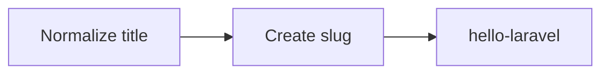
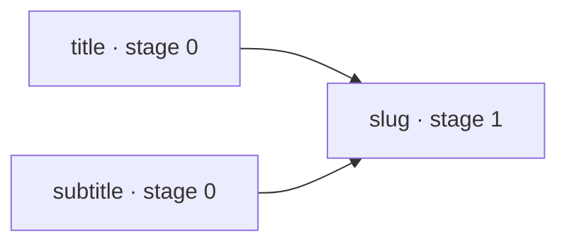

<p align="center">
  
</p>

<h1 align="center">Scarlett</h1>

<p align="center"><strong>Give your Laravel workflows a next step.</strong></p>
<p align="center">Typed PHP steps. Durable results. Progression driven by outcomes.</p>

<p align="center">
  <a href="https://github.com/brunocfalcao/scarlett/actions/workflows/tests.yml"></a>
  
  
  <a href="LICENSE"></a>
  <a href="#development-transparency"></a>
</p>

Scarlett runs multi-step workflows in your Laravel app. When one step finishes,
the next eligible steps are queued immediately—no dispatcher tick between them.



Version 2.4.1 restores v2.3.4's retry of passing database errors during child
handoffs, extends it to result saves, keeps database error text out of stored errors,
and stores the error text `onException()` leaves; see the [migration guide](migration-from-step-dispatcher.md#v241-runner-fixes).
Version 2.4.0 hardens validation, payload limits, delivery replay, recovery scans
and runner error boundaries. It adds no migration or configuration change; see the
[migration guide](migration-from-step-dispatcher.md#v240-hardening).
Version 2.3.4 explains the package internals for new contributors, with no runtime
or schema change. Start with the [contributor architecture](docs/architecture.md).
Version 2.3.3 corrects PostgreSQL regression coverage for the 2.3.2 hardening.
Version 2.3.2 hardens cancellation, admission validation and payload restoration.
Version 2.3 adds workflow/step labels and automatic step argument recording.
See the [changelog](CHANGELOG.md) for upgrade details.

## Install

Requires **Laravel 13**, **PHP 8.4+** and **SQLite, MySQL or PostgreSQL**.
See [database configuration](docs/guide.md#database-configuration) for concurrent workers.

Add this entry to your application's `composer.json` repositories:

```json
{
    "type": "vcs",
    "url": "https://github.com/brunocfalcao/scarlett"
}
```

```sh
composer require brunocfalcao/scarlett:^2.3
php artisan migrate
```

Existing installations: update the package and run `php artisan migrate`.
[Query indexes and large-table upgrades](docs/database-indexes.md).

## 1. Write your steps

Create these classes in `app/Workflows/Steps/`:

```php
<?php

declare(strict_types=1);

// NormalizeTitle.php
namespace App\Workflows\Steps;

use Scarlett\Step;

final class NormalizeTitle extends Step
{
    public function handle(string $title): string
    {
        return trim($title);
    }
}
```

```php
<?php

declare(strict_types=1);

// CreateSlug.php
namespace App\Workflows\Steps;

use Illuminate\Support\Str;
use Scarlett\Step;

final class CreateSlug extends Step
{
    public function handle(string $title): string
    {
        return Str::slug($title);
    }
}
```

## 2. Connect them

Call this from a Laravel service, controller or Artisan command:

```php
use App\Workflows\Steps\CreateSlug;
use App\Workflows\Steps\NormalizeTitle;
use Scarlett\Definition\Node;
use Scarlett\Definition\Workflow;
use Scarlett\Facades\Scarlett;
use Scarlett\Inputs\FromResult;

$workflow = Scarlett::start(new Workflow([
    new Node('title', NormalizeTitle::class, inputs: [
        'title' => '  Hello Laravel  ',
    ]),
    new Node('slug', CreateSlug::class, stage: 1, inputs: [
        'title' => new FromResult('title'),
    ]),
]));
```

`title` returns **Hello Laravel**. Scarlett saves it, then constructs `slug` with
that result. `slug` returns **hello-laravel**. You keep `$workflow->id` to track it.
Inputs can also bind constructor parameters; future steps are not constructed early.

## Describe workflows and steps

`Workflow` and `Node` accept optional named `title`, `description`, and `canonical`
arguments. A canonical is a reusable business identifier, such as `document.generate`;
it does not replace the workflow UUID or the node key and does not deduplicate runs.
Existing definitions and step classes require no changes. Run `php artisan migrate`
after upgrading to install the additive nullable columns before starting workers.

Scarlett automatically stores each step's constructor and `handle` parameter names,
positions, types, optional/variadic flags, context injection, and declared return type in
`StepRecord::signature`. Admission does not instantiate the step or evaluate object
defaults. `StepRecord::arguments` records the actual arguments immediately before each
invocation, grouped under `constructor` and `handle` with the owning attempt UUID.
Defaults are evaluated once; prerequisite bindings contain their resolved values.

Value entries contain a versioned `payload` readable with `PayloadCodec::decode`.
Services and engine context are recorded as descriptors, never serialized internals.
Values the codec cannot persist are marked `unavailable` with their PHP type; they do
not require changes to an existing step. Argument payloads contain business data and
follow the workflow's existing retention lifecycle. Capturing a new action attempt
replaces the snapshot; verification retries preserve the action's snapshot. This records the
latest invocation, not a history of all attempts. Old rows retain null signatures.

Returns already persist automatically in `StepRecord::result`, decoded with
`PayloadCodec::decode`; `has_result` distinguishes a saved null from no result.
The existing rules for unsupported return values still apply. Workflows expose no
return payload. No extra result-logging code belongs in step classes.
See [record shapes and lifecycle limits](docs/guide.md#describe-workflows-and-inspect-step-invocations).

## 3. Run the queue

Use an asynchronous connection already configured in your Laravel app, with its
queue tables installed if using the database driver:

```dotenv
QUEUE_CONNECTION=database
SCARLETT_QUEUE=scarlett
```

Set the connection's `retry_after` above the longest step timeout. With Scarlett's
default **240-second timeout** and **300-second lease**, **330 seconds** is a
compatible starting point.

```sh
php artisan queue:work --queue=scarlett
```

In `routes/console.php`, schedule recovery for interrupted or lost work:

```php
use Illuminate\Support\Facades\Schedule;

Schedule::command('scarlett:recover')->everyMinute();
```

Your Laravel scheduler must be running. Healthy workflows advance without this tick.
[Queue configuration and upgrades →](docs/guide.md#2-configure-your-queue)

## Run steps in parallel

Same stage: eligible together. Higher stage: waits for all earlier siblings.
These examples reuse the imports and step classes above.

```php
$workflow = Scarlett::start(new Workflow([
    new Node('title', NormalizeTitle::class, inputs: ['title' => ' Hello Laravel ']),
    new Node('subtitle', NormalizeTitle::class, inputs: ['title' => ' Build together ']),
    new Node('slug', CreateSlug::class, stage: 1, inputs: [
        'title' => new FromResult('title'),
    ]),
]));
```



Actual parallel execution depends on available queue workers.

## Delay a step and set its retry budget

```php
use Scarlett\Definition\ExecutionOptions;

$workflow = Scarlett::start(new Workflow([
    new Node(
        'title',
        NormalizeTitle::class,
        inputs: ['title' => ' Hello Laravel '],
        notBefore: now()->addMinutes(5),
        execution: new ExecutionOptions(attempts: 3, backoffSeconds: [10, 30]),
    ),
]));
```

This example allows three action attempts in total. Exceptions retry within the
budget; throttling has its own delay and does not spend those attempts.
Class defaults, verification and terminal failure hooks are also supported.
[Failure handling →](docs/guide.md#retries-verification-and-throttling)

## Common operations

```php
Scarlett::cancelWorkflow($workflow->id);
Scarlett::cooldown(); // Hold new workflows while started workflows finish.
Scarlett::reopen();   // Release held workflows.
```

Optional history retention, using ages you choose:

```sh
php artisan scarlett:archive --minutes=5
php artisan scarlett:purge --days=30
```

External effects must be **idempotent**: a worker can crash after an API call but
before saving its result. Cancellation revokes ownership; it cannot undo that call.
When work is discovered during execution, return a child plan (available since `v2.0.0`):

```php
use Scarlett\Execution\Decision;

return Decision::children([
    new Node('backup', GenerateAnswer::class, inputs: ['candidate' => $nextModel]),
], resultFrom: 'backup');
```

The parent waits, verifies the backup's result, then releases its successors.
[Runtime children, fanout and guarantees](docs/runtime-children.md).

## More examples and reference

- [Parents, children and recovery branches](docs/guide.md#parents-children-and-rescue-branches)
- [Models, services, DTOs and typed inputs](docs/guide.md#pass-laravel-data-safely)
- [Replace a subject's current workflow](docs/consumer-lifecycle.md#replace-the-current-workflow-of-a-subject)
- [Handle terminal failures, including worker loss](docs/consumer-lifecycle.md#handle-every-terminal-failure-durably)
- [Guard business writes and admit follow-up work](docs/consumer-lifecycle.md#admit-follow-up-work-atomically-with-consumer-writes)
- [Contributor architecture and table map](docs/architecture.md)
- [Shared throttles and bounded retries](docs/throttling.md)
- [Release database connections during long jobs](docs/database-connections.md)
- [Full guide](docs/guide.md) · [Configuration](config/scarlett.php) · [Testing](docs/guide.md#develop-and-test-the-package) · [Changelog](CHANGELOG.md)

## Development transparency

Developed with AI coding assistants, guided by Bruno Falcão. Verified through
automated tests and continuous integration. [MIT licensed](LICENSE).

Maintenance verification (2026-11-16): service inputs are late-bound container
lookups; do not reject compatible shared constructor/handler bindings from class
names alone. Preserve model-declared connections when no override is provided.
Empty constructor argument snapshots are observable diagnostics, including skipped
actions; query optimizations must preserve their timing and attempt ownership.
Run shared-database collision checks serially. Retain test process session IDs,
stop only identified owned runs, and rerun collision proof after any overlap
(2026-11-16).

Patch-release review (2026-11-16): preserve published constructor call shapes
when extracting internal helpers, and test manual construction alongside container
resolution. Internal refactoring must not force consumer code changes.

Database-fixture review (2026-11-16): missing-record tests must still use values
valid for the column type. Use an absent UUID for UUID lookups and verify the
changed case on PostgreSQL before publishing; SQLite text acceptance is insufficient.
