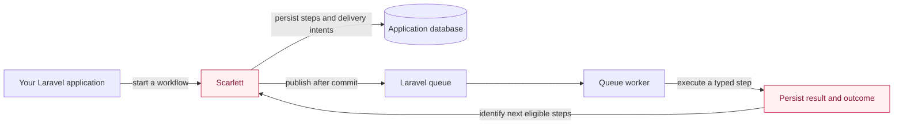
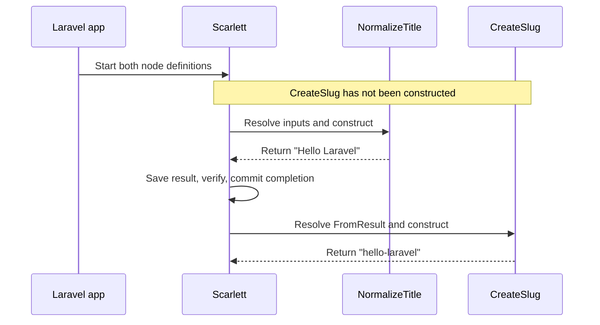
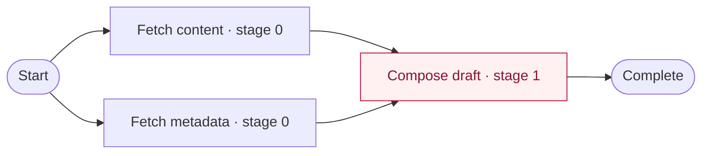
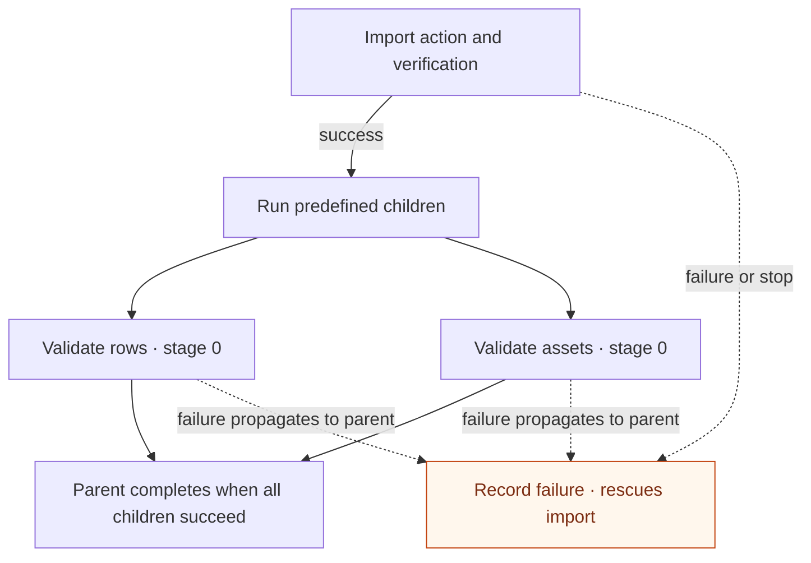

<p align="center">
  
</p>

<h1 align="center">Scarlett</h1>

<p align="center"><strong>Give your Laravel workflows a next step.</strong></p>
<p align="center">Typed PHP steps. Durable results. Progression driven by outcomes.</p>

<p align="center">
  <a href="https://github.com/brunocfalcao/scarlett/actions/workflows/tests.yml"></a>
  
  
  <a href="LICENSE"></a>
</p>

<p align="center">
  <a href="#install-in-laravel">Install</a> ·
  <a href="#your-first-workflow">Quick start</a> ·
  <a href="#shape-your-workflow">Workflow shapes</a> ·
  <a href="#retries-verification-and-throttling">Failure handling</a> ·
  <a href="#operate-in-laravel">Operations</a>
</p>

---

Scarlett coordinates multi-step work inside your Laravel application. Define the
steps and their relationships up front. When an outcome is committed, Scarlett
identifies eligible successors and publishes their jobs after the transaction commits.

**Normal progression never waits for a scheduler tick.** Laravel queue workers
still fetch jobs normally; queue capacity and explicit delays determine when work
actually starts. Periodic recovery repairs interrupted execution and lost deliveries.



| You define | Scarlett coordinates | Laravel provides |
| --- | --- | --- |
| Step classes and typed inputs | Late construction and result binding | Service container and Eloquent |
| Stages, children and rescue branches | Dependencies and durable progression | Database transactions and queues |
| Retry, verification and throttle policies | Attempts, leases and recovery | Queue workers and scheduled commands |

## Install in Laravel

Requires **Laravel 13**, **PHP 8.4+**, and an application database. MySQL is the
supported database for concurrent deployments. SQLite is useful for local and
isolated tests; PostgreSQL has not been verified.

### 1. Add the package

Add this repository entry to your application's existing `composer.json`
`repositories` configuration:

```json
{
    "type": "vcs",
    "url": "https://github.com/brunocfalcao/scarlett"
}
```

Then install from the development branch:

```sh
composer require brunocfalcao/scarlett:dev-main
php artisan migrate
```

Laravel discovers Scarlett's service provider automatically. It registers the
configuration, package migrations and `scarlett:recover` command. For local package
development, Composer also supports a symlinked [path repository](https://getcomposer.org/doc/05-repositories.md#path).

### 2. Configure your queue

Publish the configuration when you want to customize defaults:

```sh
php artisan vendor:publish --tag=scarlett-config
```

Choose an asynchronous queue connection already configured in your Laravel app.
For example, with Laravel's database queue and its jobs table installed:

```dotenv
QUEUE_CONNECTION=database
SCARLETT_QUEUE=scarlett
```

Before starting workers, set that connection's `retry_after` in `config/queue.php`
above Scarlett's worker timeout. Package defaults are **240 seconds for the worker**
and **300 seconds for the execution lease**. A queue `retry_after` of **330 seconds**
is one compatible starting point; tune all three for your workload. Per-step
overrides must also fit the queue settings. See [Laravel's timeout guidance](https://laravel.com/docs/13.x/queues#job-expirations-and-timeouts).

```sh
php artisan queue:work --queue=scarlett
```

`SCARLETT_QUEUE_CONNECTION` optionally overrides the application's default queue
connection. Your worker must listen to the same connection and queue. The `sync`
connection is suitable for immediate examples, but cannot provide delayed retries.

> **Package upgrades:** run ordinary `php artisan migrate` after updating Scarlett.
> Migrations load from the package; do not copy or publish them into your app.
> Pause admission and drain/stop existing workers before a code/schema upgrade,
> apply migrations, then start updated workers. Existing migration filenames stay
> stable; new schema changes use additive migrations.

## Your first workflow

Create two ordinary PHP classes under `app/Workflows/Steps/`. They extend
`Scarlett\Step`; Scarlett supplies the queue job that executes them.

**`app/Workflows/Steps/NormalizeTitle.php`**

```php
<?php

declare(strict_types=1);

namespace App\Workflows\Steps;

use Scarlett\Step;

final class NormalizeTitle extends Step
{
    public function __construct(private string $title) {}

    public function handle(): string
    {
        return trim($this->title);
    }
}
```

**`app/Workflows/Steps/CreateSlug.php`**

```php
<?php

declare(strict_types=1);

namespace App\Workflows\Steps;

use Illuminate\Support\Str;
use Scarlett\Step;

final class CreateSlug extends Step
{
    public function __construct(private string $title) {}

    public function handle(): string
    {
        return Str::slug($this->title);
    }
}
```

Start the workflow from an application service, controller action or Artisan command:

```php
use App\Workflows\Steps\CreateSlug;
use App\Workflows\Steps\NormalizeTitle;
use Scarlett\Definition\Node;
use Scarlett\Definition\Workflow;
use Scarlett\Facades\Scarlett;
use Scarlett\Inputs\FromResult;

$workflow = Scarlett::start(new Workflow([
    new Node('title', NormalizeTitle::class, inputs: [
        'title' => '  Hello Laravel  ',
    ]),
    new Node('slug', CreateSlug::class, stage: 1, inputs: [
        'title' => new FromResult('title'),
    ]),
]));

$workflowId = $workflow->id;
```

The first step returns `Hello Laravel`; the second receives that committed value
and returns `hello-laravel`.

### Construction happens when the step can run

A node stores a **class reference and named bindings**, not a constructed business
object. Validation uses reflection without constructing steps or resolving services.



Keep constructors free of external side effects: input preparation can repeat.
Use a public, non-static `handle()` with your own typed parameters and return type.
Named inputs can bind constructor or handler parameters; defaults and variadic
lists are supported. Unknown/missing inputs and reference parameters are rejected.
Literal types are checked at admission; deferred values are checked at execution.
Scalar values are not silently coerced.

## Shape your workflow

### Sequential and parallel stages

Lower stages complete before higher stages **within the same sibling group**.
Equal-stage siblings are eligible together; actual concurrency depends on workers.



All earlier siblings are prerequisites, even when their results are not inputs.
`FromResult` supplies data; **stages establish sibling ordering**. A reference to
another same-stage sibling is not a valid prerequisite binding.

### Parents, children and rescue branches

Define the whole tree before starting. A parent runs and verifies its own action,
then waits for its children. Children may read the parent's committed action result.
A `rescues` node becomes eligible when its target definitively fails or stops.



| Node option | Meaning |
| --- | --- |
| `stage` | Order siblings; the default is `0`. |
| `parent: 'import'` | Attach a predefined child to `import`. |
| `rescues: 'import'` | Attach a recovery root to `import`; it may have its own children. |
| `notBefore` | Earliest absolute start time, using a `DateTimeInterface`. Prerequisites must also be ready. |
| `priority` | Prioritize publication among eligible nodes; never bypass dependencies. |
| `queue`, `connection` | Route the node to a Laravel queue and connection. |
| `execution` | Persist per-step timeouts and retry settings when the workflow starts. |

Skip produces no result and skips unstarted descendants. Failure/stop cancels
unstarted dependent work; already-running siblings retain their own ownership.
Cancellation revokes authority but cannot interrupt an external call already running.
Unused rescue branches are skipped. **A successful rescue does not erase the original
failure, reopen cancelled successors, or turn a failed workflow into a successful one.**

Dynamic child creation and separate table-prefix execution scopes are deferred.
Recurring schedules and calendar windows belong in your Laravel application.

## Pass Laravel data safely

Queue payloads carry step and attempt identities. Business inputs and results use
Scarlett's versioned JSON representation and are restored when execution begins.

| Data you need | Binding or configuration | When it is resolved |
| --- | --- | --- |
| Literal scalar, array or null | Named `inputs` value | Saved at admission |
| A prerequisite's result | `new FromResult('title')` | After the prerequisite produces its result |
| A container service | `new Service(MyService::class)` from `Scarlett\Inputs` | At execution, through Laravel's container |
| A current Eloquent record | `new ModelReference('article', $id)` from `Scarlett\Inputs`; register the model in `scarlett.models` | At execution; missing records fail clearly |
| A snapshot | Explicit array or mapped DTO | Captured when supplied |
| A DTO/value object | Implement `Scarlett\Contracts\PayloadMapper`; register in `scarlett.payload_mappers` | Encoded for storage, restored for execution |
| A backed enum | Register a stable alias in `scarlett.enums` | Encoded and restored through the alias |
| Dates and collections | Built-in codec | Dates become `DateTimeImmutable`; collections become Support collections |

Bare Eloquent models, arbitrary objects, closures and resources are rejected.
Dates preserve named timezones; the codec also reads older version-1 date payloads.
Version mapper aliases when their representation changes. A mapper's encoded value
must itself be supported by the codec.

`FromResult` is a top-level named binding to an earlier sibling, parent action or
rescue target. It does not evaluate closures or expressions. A rescue target or
skipped step may have no result; do not require one unless that path guarantees it.
Combine complex predecessor values inside a step, using your own typed DTO.

## Retries, verification and throttling

The lifecycle separates **doing the work**, **saving its result**, and **confirming
that the saved result is acceptable**.

| Extension point | Purpose | Default |
| --- | --- | --- |
| `before(Context): ?Decision` | Skip, stop, fail, retry, throttle or supply a result | Return `null` to run the action |
| `handle(...)` | Perform your business action | Implement in each step |
| `verify(Context, mixed $result): bool` | Confirm the decoded durable result | Return `true` |
| `onException(Throwable, Context): Decision` | Classify constructed action/precheck/throttle errors | Retry within the configured budget |
| `throttle(): ?Throttle` | Defer until a rate-limit policy permits execution | No throttle |

Import `Context` and `Decision` from `Scarlett\Execution`, and `Throttle` from
`Scarlett\Policies`. A throttle policy's `delay(Context)` returns `null` to proceed
or seconds to wait. Throwing `Scarlett\Exceptions\Throttled` also defers execution.

| Situation | What happens next | Budget |
| --- | --- | --- |
| Temporary input preparation failure | Resolve inputs/construct again after backoff | Action budget, or verification budget if the action was already saved |
| Invalid/deleted input | Terminal failure by default | Configurable exception classification |
| Action exception | Ask `onException` for a decision | Action retry budget |
| Result-saving failure | Fail without classifying it as another action attempt | No automatic action retry on this error path |
| Saved result cannot be restored, or verification fails | Retry restoration/verification; do not rerun the saved action | Separate verification budget |
| Throttle | Defer execution | Does not spend failure retries |
| Zero-second throttle | Wait `scarlett.minimum_throttle_seconds` (default `1`) | Does not spend failure retries |

Explicit positive throttle waits and ordinary zero-second retries keep their given
meaning. Accepted results from hooks still undergo verification. Put required terminal
business updates in predefined rescue steps: a killed worker or exhausted verification
is not guaranteed to invoke `onException`.

<details>
<summary><strong>Customize budgets and exception policies</strong></summary>

Configure defaults in `config/scarlett.php`. The default action and verification
budgets each allow three attempts. `Scarlett\Definition\ExecutionOptions` supports
`workerTimeout`, `leaseSeconds`, `attempts`, `backoffSeconds`, `verificationAttempts`
and `verificationBackoffSeconds`; pass it as a node's `execution` option. Read
application-specific values from your Laravel configuration. Effective settings
are persisted at admission, so later configuration changes do not alter active budgets.

`scarlett.retry_policy` selects a `Scarlett\Policies\RetryPolicy` implementation.
Use `Policies\ExceptionHandler` as a reusable base for handlers called by your
`onException`. Before a step exists, `scarlett.input_exception_handler` selects the
preparation handler; its default is `Policies\InputExceptionHandler`.
`scarlett.input_terminal_exceptions` controls terminal classes (invalid arguments,
missing records, invalid service bindings and PHP programming errors by default).
A preparation handler cannot supply a successful result without a step instance.

</details>

## Operate in Laravel

### Schedule recovery

For example, add the following to `routes/console.php`, with your application's
[Laravel scheduler](https://laravel.com/docs/13.x/scheduling) running:

```php
use Illuminate\Support\Facades\Schedule;

Schedule::command('scarlett:recover')->everyMinute();
```

Choose the recovery interval for your workload. Healthy progression does not
need this command. It repairs lost deliveries and expired execution leases.
You can also invoke `php artisan scarlett:recover` manually.

```php
use Scarlett\Facades\Scarlett;

if (Scarlett::stalled()) {
    Scarlett::resume();
}

Scarlett::cooldown(); // Hold new workflows; let started workflows drain.
Scarlett::reopen();   // Admit held workflows.
Scarlett::cancel($stepId); // Cancel pending/queued work.
Scarlett::cancel($stepId, includingRunning: true); // Also revoke an active attempt.
Scarlett::cancelWorkflow($workflowId); // Revoke every unfinished node.
```

Set `delivery_retry_seconds` above normal queue latency. Recovery cannot distinguish
a lost job from an unclaimed backlog; replay can publish another copy of the same
attempt, while atomic claims protect execution. Early jobs release until due without
spending business retries. Unexpected job errors/timeouts fail the transport delivery;
durable engine recovery remains available. Transport delay limits still apply.

### Track application ownership and history

A `Workflow` may carry `subjectType`, `subjectId` (both strings or neither), and
JSON `metadata`. Use them to associate workflows with application records:
`Scarlett\Models\WorkflowRecord::forSubject($type, $id)` includes archived workflows.
Subjects are application-owned labels, not serialized models or foreign keys.

`Scarlett\Execution\Context` is injected automatically into constructor/handler
parameters typed exactly as `Context`; do not bind it in `inputs`. It exposes
workflow, step and attempt IDs, failure count, `heartbeat()`, `isCurrent()` and
`canRetry()`. Heartbeats extend a current lease; `canRetry()` checks whether another
action attempt remains after the current one fails.

Use `Context::whileCurrent(callable)` for database writes that must reject stale
workers. It holds the workflow lock and skips the callback if ownership was lost.
Acquire application locks inside that callback, recheck application-specific ownership,
and keep network calls outside it. All affected records must share the same database
connection. Lease expiry cannot stop an external call already in progress.

| `Scarlett\History` operation | Behavior |
| --- | --- |
| `archive($workflowId)` | Requires an existing settled workflow; returns false for active work, throws if missing |
| `delete($workflowId)` | Deletes settled history; returns false for missing or active work |
| `purge($before)` | Purges eligible archived history before your cutoff; protects active work |

`scarlett_history` records transitions, attempt identities, times and reasons.
Steps retain error/counter details, latest-claim `started_at` and settlement
`finished_at`. There is no automatic retention age.

## Extend states

Step states use **Spatie model-states**. Register subclasses of
`Scarlett\States\StepState` in `scarlett.states`, each with a unique stable `$name`.
Define their phase, dependency satisfaction, recovery and subtree-skipping semantics;
register allowed transitions in `scarlett.transitions`. A third transition entry
can select a Spatie guard class. Configuration supports Laravel config caching.

For a successful custom state, extend `States\Completed`, set a name such as
`approved`, register `Running → Approved`, and return
`Decision::complete($result, Approved::class)` from an acceptance hook. Parents
also need `WaitingForChildren → Approved`. A denied completion guard fails its
owning step and preserves successful child outcomes.

A new operational phase requires implementation and tests, beyond a state label.
Settled states cannot be reopened. Change execution through engine controls and
hooks rather than directly mutating storage models.

## Durability and boundaries

- A workflow row lock serializes claims, outcomes, cancellation and recovery.
  Attempt tokens prevent stale workers from overwriting newer engine state.
- Outcome progression and delivery intents share a transaction. Publication runs
  after commit; publishing leases suppress overlapping publishers. Failed publication
  leaves recoverable intent. Duplicate jobs cannot claim the same attempt twice.
- External effects are **at least once**. A process can crash after a remote action
  but before saving its result. Supply business idempotency keys when repetition matters.
- Accept only trusted workflow definitions. HTTP inputs must never choose arbitrary
  step classes or container bindings.
- Step keys are exact, case-sensitive UTF-8 strings of at most
  `Node::MAX_KEY_LENGTH` characters. MySQL stores identity/parent/rescue keys with
  binary comparison. Additive migrations support scheduled dates beyond 2038;
  rollback refuses collisions or dates that cannot fit the older schema.

## Develop and test the package

Run these commands from the package checkout:

```sh
composer install
./run-pest-tia.sh --filtered --testsuite=Scarlett
./run-pest-tia.sh --fresh
```

The full suite includes SQLite/Testbench checks, independent queue workers and real
MySQL contention/migration tests. It requires a dedicated `scarlett_collision_tests`
database and refuses to reset another database. Configure `SCARLETT_TEST_HOST`,
`SCARLETT_TEST_PORT`, `SCARLETT_TEST_USER` and `SCARLETT_TEST_PASSWORD`. Its database
user needs access to `performance_schema.data_locks`. Do not run concurrent collision
suites against the same test database.

Local tests use Pest TIA with Herd coverage or PCOV/Xdebug; explicit selections run
directly. CI runs exhaustive non-TIA tests. `composer format` applies Laravel Pint.

See the [changelog](CHANGELOG.md) for changes. Scarlett is [MIT licensed](LICENSE).
