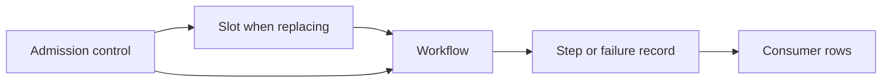

# Maintaining Scarlett

[Quick start](../README.md) · [Consumer guide](guide.md) ·
[Ownership API](consumer-lifecycle.md) · [Runtime children](runtime-children.md)

This is the implementation map for contributors. Public examples belong in the
consumer guide; comments beside the code explain the invariants an edit must keep.

## From definition to next step

```mermaid
flowchart LR
    Definition[Workflow and Node definitions] --> Admission[Engine.start transaction]
    Admission --> Store[NodeStore persists bindings and options]
    Store --> Progression[Progression finds eligible work]
    Progression --> Intent[(Delivery intent)]
    Intent --> Commit[Commit]
    Commit --> Queue[Delivery publishes job]
    Queue --> Claim[Runner claims attempt]
    Claim --> Action[Restore inputs and run action]
    Action --> Result[Persist result]
    Result --> Verify[Verify durable result]
    Verify --> Outcome[Journal settles step]
    Outcome --> Progression
```

`Workflow::validate()` inspects signatures and relationships without constructing
business steps. `NodeStore` snapshots execution settings and stores binding recipes.
Stages create dependencies on all earlier siblings within the same parent/rescue
group. `FromResult` supplies a value; it does not create a dependency itself.

`Engine` locks the workflow before changing an attempt. `Progression` then runs
until no further eligibility or settlement changes remain. Enqueuing writes a new
attempt token and a delivery intent in the same transaction. `Delivery` publishes
after the outermost commit. A transport error leaves recoverable intent instead of
rolling back a completed business action.

`Runner` claims once, restores inputs, constructs the step and checks ownership
between lifecycle hooks. Action persistence precedes verification. On redelivery
of saved work, only preparation and verification repeat. Constructors, mappers and
service resolution must therefore tolerate repeated preparation.

When configured, runners release the default connection before actions, verification
and failure hooks, and on exit. `ConnectionRelease` checks transaction and PDO
state without opening new connections. It changes no durable checkpoint or lock
order. Consumers can release again before an external call; session-local state
must not cross those boundaries. See [connection lifetime](database-connections.md).

## Responsibilities and edit boundaries

| Area | Responsibility | Keep true |
| --- | --- | --- |
| `Definition` | Declarative graph and execution defaults | No early business construction; node options replace class options |
| `Inputs`, `Contracts/PayloadMapper` | Versioned JSON and late bindings | No arbitrary object serialization; aliases remain readable for retained work |
| `Execution/ConnectionRelease` | Opt-in default-connection lifetime | Release only outside transactions; preserve memory SQLite; next query reconnects |
| `Execution/Invoker` | Typed constructor/handler calls | Explicit names, exact Context injection and strict PHP invocation |
| `Engine`, `Execution/Context` | Claims, leases and guarded mutations | A current token, running phase and future lease are all required |
| `Execution/Journal`, `States` | Transitions and durable diagnostics | State semantics drive dependency, recovery and retention consistently |
| `Execution/Progression` | Sibling barriers and subtree settlement | Rescue success never erases the original failure |
| `Execution/RuntimeChildren` | One atomic closed plan per action | Namespace local keys; persist handoff and children together |
| `Execution/Delivery`, `Jobs` | Queue transport | Primitive envelopes, after-commit publication, duplicate-safe claims |
| `Failures` | Durable terminal hooks | Separate attempts; child hooks settle before parent hooks |
| `Admission`, `WorkflowSlots`, `SubjectDeletion` | Admission and subject ownership | Engine locks precede consumer locks; veto rolls back all writes |
| `Policies/RateLimit`, `Execution/ThrottleReservations` | Shared rolling-window admission | Workflow/step/quota lock order; one grant per current attempt; waits do not spend failure retries |
| `Recovery`, `Commands` | Repair and retention entrypoints | No normal progression polling and no package-owned schedules |
| `History`, `Models` | Retained records and explicit cleanup | Lock and recheck settlement; never bypass the engine with direct model writes |
| `ScarlettServiceProvider`, `Configuration` | Laravel integration and validation | Auto-discover migrations; validate admitted execution snapshots |

## Lock order and transactional callbacks

Admission is shared for starts/replacements and exclusive for deletion,
cooldown and reopening. Ordinary step execution takes no admission lock. A step
that must start another workflow wraps the entire guarded write in
`withAdmission()` **before** entering `whileCurrent()` or locking consumer rows.
`replace()` and `deleteSubject()` must also begin before those locks.

`isCurrent()` is advisory. `whileCurrent()` combines a current locking read and
consumer writes in one transaction. It does not establish application permissions
or business eligibility; consumers recheck those inside the callback. All writes
must share the engine's database connection. Callbacks are short, database-only
and replay-safe because transaction retries may invoke them again.

Replacement revokes before its callback, then rolls everything back on a veto.
Deletion checks its callback before removing records. `withAdmission()` differs:
returning null/false does not veto; throwing rolls back. The
[lifecycle guide](consumer-lifecycle.md) contains exact signatures and examples.

## Children, rescues and terminal hooks

A predefined parent verifies its own result before releasing children. A runtime
parent commits one child plan, waits for its subtree, optionally adopts a direct
child's result, then receives a verification attempt. Neither path releases its
successors before the parent settles successfully.

A failed child closes unstarted ordinary sibling admission. Running siblings and
all descendant rescue branches drain before the parent fails and activates its
own rescues. Rescues of failed rescues follow the same bottom-up rule. Durable
failure hooks are a separate path: their coordinator waits for ordinary descendant
hooks, while rescue progression does not wait for hooks. Workflow settlement waits
for both step settlement and unfinished failure records.

`onException()` classifies errors in a live action path. It cannot run after a
worker is killed. Terminal effects belong in `onFailure()`; reconstruction failure
uses `onFailureWithoutInstance()` with saved identifiers. A handler may be retried
after its effect but before acknowledgement. Use its stable logical failure ID
for idempotency; exactly-once external effects are not promised.

## Storage ownership

Eight package tables serve different lifecycles:

| Table | Stored responsibility |
| --- | --- |
| `scarlett_control` | Admission lock row and cooldown flag |
| `scarlett_workflows` | Aggregate status, subject, metadata and lifecycle/archive times |
| `scarlett_steps` | Definition, bindings, result, state, latest attempt, budgets, routing, timing and child handoff |
| `scarlett_deliveries` | Durable step transport intents and publication leases |
| `scarlett_history` | Append-only transition events with attempt, time and reason |
| `scarlett_subject_slots` | Exact hashed subject/slot identity and current workflow pointer |
| `scarlett_throttles` | Shared admission timestamps, consistent policy settings and expiry |
| `scarlett_failures` | One opted-in terminal failure record per step, snapshot and handler attempt lifecycle |

Relationships use restrictive foreign keys where declared. History cleanup deletes
failure, history and delivery rows before steps and workflows. The slot pointer
intentionally has no foreign key: deleting history must not acquire a slot lock
after a workflow lock. Current-workflow reads join against retained workflows,
so a removed workflow is omitted even when its old pointer remains. Subject
removal additionally removes its slots.

`archive()` marks rows in place. `purge()` removes settled archived graphs older
than a caller-supplied cutoff. Both recheck live state under the workflow lock;
unfinished failure hooks protect the workflow from ordinary cleanup.

Ten ordered package migrations define this schema. Published migration files
are immutable, including comments. Add a new migration for schema changes and
verify fresh install, retained-data upgrade, repeat migration and rollback on
SQLite, MySQL and PostgreSQL. See [query indexes](database-indexes.md) for current
coverage and large-table DDL limitations. Version 2.1.0 adds throttle storage;
see [throttling](throttling.md) for its rollout and rollback conditions.

## Reading telemetry correctly

The step row holds the latest claim's `started_at` and settlement `finished_at`.
Their difference is elapsed time, potentially including waits and child execution;
it is not CPU time, full workflow latency or an aggregate of all attempt durations.
A new claim replaces the start timestamp. History retains individual transitions,
not an external-call profiler. `failures` and `verifications` are separate counters.
`has_result` distinguishes a produced null from an absent result.

## Verification ownership

Package feature tests exercise graph, payload, state and lifecycle contracts.
`tests/Support/functions.php` drives actual attempts and compares explicit state
maps. Collision tests use independent PHP workers and observed contention;
`tests/Collision/Environment.php` refuses a database outside the dedicated test
resources. Queue tests exercise serialized jobs through real database and Redis queues.
Recovery enumerates candidates in bounded ID-based batches, closing read cursors
before acquiring write locks. Each action or failure-handler recovery still
rechecks current eligibility under its workflow lock. This prevents an old SQLite
read snapshot from blocking a concurrent recovery write.

The separate Laravel host owns the synthetic quote HTTP/worker integration and
isolated stress command. Its pending testing UI is distinct from the read-only
`brunocfalcao/scarlett-ui` package. Neither host nor dashboard is a core dependency.

Use [the documented test commands](guide.md#develop-and-test-the-package).
Changing a comment must not alter PHP tokens, annotations or runtime configuration.
Review the complete diff, retain published migrations byte-for-byte, and run the
release's full three-database and host gates before publishing a new source tag.
