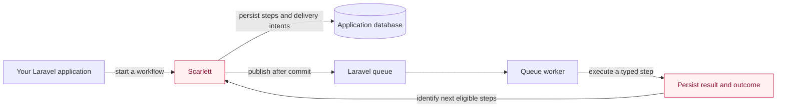
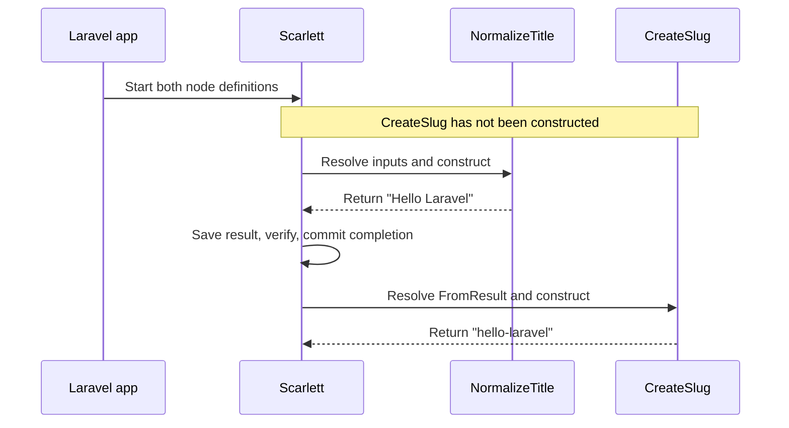
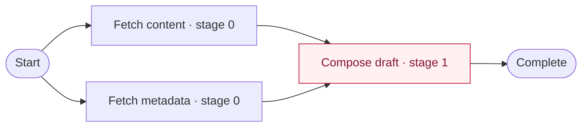
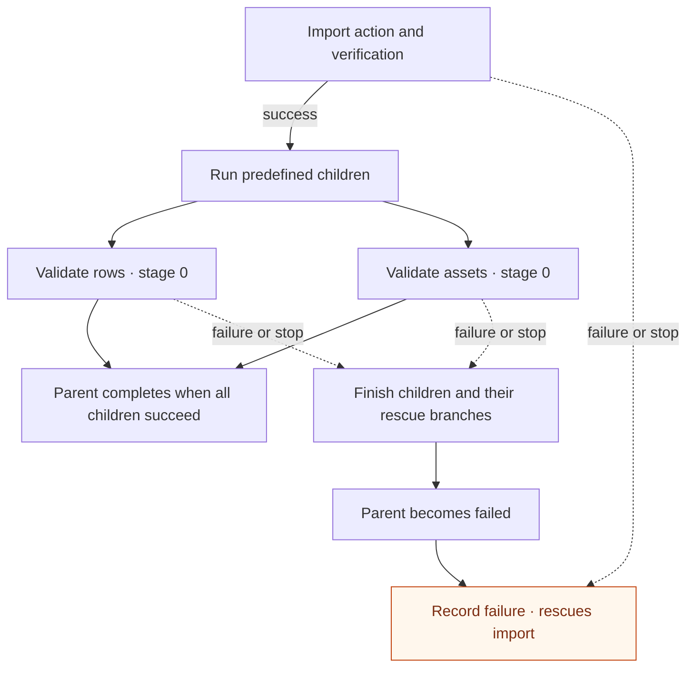
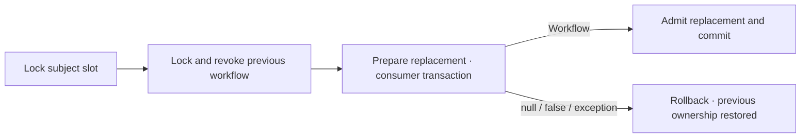

# Scarlett guide

[Back to the quick start](../README.md)

Scarlett coordinates multi-step work inside your Laravel application. Define the
initial steps and relationships up front; a running step may return a closed
[runtime child plan](runtime-children.md). When an outcome is committed, Scarlett
identifies eligible successors and publishes their jobs after the transaction commits.

**Normal progression never waits for a scheduler tick.** Laravel queue workers
still fetch jobs normally; queue capacity and explicit delays determine when work
actually starts. Periodic recovery repairs interrupted execution and lost deliveries.



| You define | Scarlett coordinates | Laravel provides |
| --- | --- | --- |
| Step classes and typed inputs | Late construction and result binding | Service container and Eloquent |
| Stages, children and rescue branches | Dependencies and durable progression | Database transactions and queues |
| Retry, verification and throttle policies | Attempts, leases and recovery | Queue workers and scheduled commands |

## Install in Laravel

Requires **Laravel 13**, **PHP 8.4+**, and **SQLite, MySQL or PostgreSQL**.

### Database configuration

MySQL and PostgreSQL use row locks. SQLite serializes writers; for multiple workers,
configure the application's SQLite connection in `config/database.php`:

```php
'journal_mode' => 'WAL',
'busy_timeout' => 10000,
'transaction_mode' => 'IMMEDIATE',
```

Choose a busy timeout suitable for your workload and keep transactions short.
`IMMEDIATE` acquires the writer lock before reads, avoiding a deferred transaction's
read-to-write upgrade race. SQLite permits only one writer at a time; use MySQL or
PostgreSQL when concurrent database writes are a workload requirement. The suite's
SQLite contention checks use this configuration, not Laravel's deferred default.

### 1. Add the package

Add this repository entry to your application's existing `composer.json`
`repositories` configuration:

```json
{
    "type": "vcs",
    "url": "https://github.com/brunocfalcao/scarlett"
}
```

Then install the tagged stable release:

```sh
composer require brunocfalcao/scarlett:^2.3
php artisan migrate
```

Laravel discovers Scarlett's service provider automatically. It registers the
configuration, package migrations and the `scarlett:recover`, `scarlett:archive`,
`scarlett:purge` and `scarlett:prune-throttles` commands. For local package
development, Composer also supports a symlinked [path repository](https://getcomposer.org/doc/05-repositories.md#path).

### 2. Configure your queue

Publish the configuration when you want to customize defaults:

```sh
php artisan vendor:publish --tag=scarlett-config
```

Choose an asynchronous queue connection already configured in your Laravel app.
For example, with Laravel's database queue and its jobs table installed:

```dotenv
QUEUE_CONNECTION=database
SCARLETT_QUEUE=scarlett
```

Before starting workers, set that connection's `retry_after` in `config/queue.php`
above Scarlett's worker timeout. Package defaults are **240 seconds for the worker**
and **300 seconds for the execution lease**. A queue `retry_after` of **330 seconds**
is one compatible starting point; tune all three for your workload. Per-step
overrides must also fit the queue settings. See [Laravel's timeout guidance](https://laravel.com/docs/13.x/queues#job-expirations-and-timeouts).

```sh
php artisan queue:work --queue=scarlett
```

`SCARLETT_QUEUE_CONNECTION` optionally overrides the application's default queue
connection. Your worker must listen to the same connection and queue. The `sync`
connection is suitable for immediate examples, but cannot provide delayed retries.

> **Package upgrades:** run ordinary `php artisan migrate` after updating Scarlett.
> Migrations load from the package; do not copy or publish them into your app.
> Pause admission and drain/stop existing workers before a code/schema upgrade,
> apply migrations, then start updated workers. Existing migration filenames stay
> stable; new schema changes use additive migrations.

## Your first workflow

Create two ordinary PHP classes under `app/Workflows/Steps/`. They extend
`Scarlett\Step`; Scarlett supplies the queue job that executes them.

**`app/Workflows/Steps/NormalizeTitle.php`**

```php
<?php

declare(strict_types=1);

namespace App\Workflows\Steps;

use Scarlett\Step;

final class NormalizeTitle extends Step
{
    public function __construct(private string $title) {}

    public function handle(): string
    {
        return trim($this->title);
    }
}
```

**`app/Workflows/Steps/CreateSlug.php`**

```php
<?php

declare(strict_types=1);

namespace App\Workflows\Steps;

use Illuminate\Support\Str;
use Scarlett\Step;

final class CreateSlug extends Step
{
    public function __construct(private string $title) {}

    public function handle(): string
    {
        return Str::slug($this->title);
    }
}
```

Start the workflow from an application service, controller action or Artisan command:

```php
use App\Workflows\Steps\CreateSlug;
use App\Workflows\Steps\NormalizeTitle;
use Scarlett\Definition\Node;
use Scarlett\Definition\Workflow;
use Scarlett\Facades\Scarlett;
use Scarlett\Inputs\FromResult;

$workflow = Scarlett::start(new Workflow([
    new Node('title', NormalizeTitle::class, inputs: [
        'title' => '  Hello Laravel  ',
    ]),
    new Node('slug', CreateSlug::class, stage: 1, inputs: [
        'title' => new FromResult('title'),
    ]),
]));

$workflowId = $workflow->id;
```

The first step returns `Hello Laravel`; the second receives that committed value
and returns `hello-laravel`.

### Construction happens when the step can run

A node stores a **class reference and named bindings**, not a constructed business
object. Validation uses reflection without constructing steps or resolving services.



Keep constructors free of external side effects: input preparation can repeat.
Use a public, non-static `handle()` with your own typed parameters and return type.
Named inputs can bind constructor or handler parameters; defaults and variadic
lists are supported. Unknown/missing inputs and reference parameters are rejected.
Literal types are checked at admission; deferred values are checked at execution.
Scalar values are not silently coerced.

## Shape your workflow

### Sequential and parallel stages

Lower stages complete before higher stages **within the same sibling group**.
Equal-stage siblings are eligible together; actual concurrency depends on workers.



All earlier siblings are prerequisites, even when their results are not inputs.
`FromResult` supplies data; **stages establish sibling ordering**. A reference to
another same-stage sibling is not a valid prerequisite binding.

### Parents, children and rescue branches

For predefined children, define the tree before starting. A parent runs and
verifies its own action, then waits for its children. Children may read the parent's committed action result.
A `rescues` node becomes eligible when its target definitively fails or stops.
Failure cascades **from child to parent**. The parent stays `waitingforchildren`
until its children and their complete rescue branches settle. This includes
parallel resolvers, later resolver stages, nested children, and rescues of failed
resolvers. Already-running siblings may finish and run their own recovery;
unstarted ordinary siblings are cancelled. Only then does the parent become
`failed` and admit its own rescue branch. The same rule repeats at every level.



| Node option | Meaning |
| --- | --- |
| `stage` | Order siblings; the default is `0`. |
| `parent: 'import'` | Attach a predefined child to `import`. |
| `rescues: 'import'` | Attach a recovery root to `import`; it may have its own children. |
| `notBefore` | Earliest absolute start time, using a `DateTimeInterface`. Prerequisites must also be ready. |
| `priority` | Prioritize publication among eligible nodes; never bypass dependencies. |
| `queue`, `connection` | Route the node to a Laravel queue and connection. |
| `execution` | Persist per-step timeouts and retry settings when the workflow starts. |

Skip produces no result and skips unstarted descendants. Failure/stop cancels
unstarted dependent work; already-running siblings retain their own ownership, and
the affected parent waits for running siblings and descendant rescue branches to
settle. Cancellation revokes authority but cannot interrupt an external call already
running.
Unused rescue branches are skipped. **A successful rescue does not erase the original
failure, reopen cancelled successors, or turn a failed workflow into a successful one.**

Resolvers targeting the same key form a recovery group within the same workflow:
equal `stage` values run in parallel; later stages await all earlier stages.
No separate block UUID is needed. Throttles and retries keep the parent waiting;
exhausted resolvers settle as failed and may activate their own rescues.
Durable `onFailure` hooks have separate child-before-parent ordering; rescue
progression does not wait for those hooks to finish.

Use [runtime child plans](runtime-children.md) for data-dependent fanout or nested
backups discovered during execution. A parent returns one complete plan; it waits
for the children and then verifies the effective result. Incremental appending and
separate table-prefix execution scopes remain deferred.
Recurring schedules and calendar windows belong in your Laravel application.

## Describe workflows and inspect step invocations

Both `Workflow` and `Node` accept optional named `title`, `description` and
`canonical` arguments. They default to null and require no changes to existing
step classes. Canonicals are reusable business labels, not uniqueness constraints;
workflow/step UUIDs and node keys keep their current roles. Slot replacement
preserves the new workflow labels. Runtime children retain their labels even when
Scarlett qualifies their node keys.

```php
$definition = new Workflow([
    new Node('title', NormalizeTitle::class, inputs: ['title' => ' Hello '],
        title: 'Normalize title', description: 'Trim surrounding whitespace.',
        canonical: 'document.title.normalize'),
], title: 'Prepare document', canonical: 'document.prepare');
```

Read the labels from `WorkflowRecord` and `StepRecord`. Each newly admitted step
also has a `signature` array with `constructor` and `handle` entries. Each entry
contains `parameters`, keyed by name, and nullable `return_type`. Parameter fields
are `position` (zero-based), nullable `type`, `optional`, `variadic` and `context`.
Reflection records declarations without constructing steps or evaluating defaults.
Use `position` for ordering; JSON object key order is not a database contract.

Immediately before construction or `handle()`, Scarlett stores the actual argument
values in `StepRecord::arguments`. Its `attempt` is the owning attempt UUID;
`constructor` and `handle` contain parameter-name maps. Variadics are grouped into
one list. Defaults are evaluated once per invocation, and `FromResult` values are
resolved before capture. Each parameter entry is one of:

| Kind | Recorded fields |
| --- | --- |
| `value` | `payload`: versioned data readable with `PayloadCodec::decode()` |
| `context` | Descriptor only; no engine context internals |
| `service` | `class`: requested service binding; no service internals |
| `unavailable` | `type`: PHP type when codec/JSON encoding cannot represent the value |

Snapshots are diagnostics, not replay inputs or proof that an invocation finished.
They contain business data and follow existing history retention. Payload mappers
may run additionally during capture and must remain free of business side effects.
A new action attempt replaces the snapshot when its arguments are recorded;
verification retries preserve the completed action's snapshot. When `before()`
skips the action, there is no `handle` entry. Cancelled, expired or replaced attempts cannot write a
snapshot. This is the latest captured action attempt, not a per-attempt history.

Return values retain the existing `StepRecord::result` encoding and `has_result`
flag, including saved null, false, zero and empty values. Workflows have no return
payload. Unsupported return values still follow the existing persistence failure
rules; the diagnostic fallback does not change those rules.

Upgrade with ordinary `php artisan migrate` before running updated workers.
The additive v2.3 migration leaves existing rows' signatures and labels null;
executing an old pending step can capture its arguments without backfilling its
declaration. Rollback removes these new diagnostics and labels, preserving the
existing inputs, results and execution state.

## Pass Laravel data safely

Queue payloads carry step and attempt identities. Business inputs and results use
Scarlett's versioned JSON representation and are restored when execution begins.

| Data you need | Binding or configuration | When it is resolved |
| --- | --- | --- |
| Literal scalar, array or null | Named `inputs` value | Saved at admission |
| A prerequisite's result | `new FromResult('title')` | After the prerequisite produces its result |
| A container service | `new Service(MyService::class)` from `Scarlett\Inputs` | At execution, through Laravel's container |
| A current Eloquent record | `new ModelReference('article', $id)` from `Scarlett\Inputs`; register the model in `scarlett.models` | At execution; missing records fail clearly |
| A snapshot | Explicit array or mapped DTO | Captured when supplied |
| A DTO/value object | Implement `Scarlett\Contracts\PayloadMapper`; register in `scarlett.payload_mappers` | Encoded for storage, restored for execution |
| A backed enum | Register a stable alias in `scarlett.enums` | Encoded and restored through the alias |
| Dates and collections | Built-in codec | Dates become `DateTimeImmutable`; collections become Support collections |

Bare Eloquent models, arbitrary objects, closures and resources are rejected.
Dates preserve named timezones; the codec also reads older version-1 date payloads.
Configured enum, model and throttle registries may use string or integer aliases.
Each visited payload node validates its type and required keys; a malformed
stored node raises a single `InvalidArgumentException`, and unsupported resources
fail without mapper resolution. Every stored string (values, keys, enum backing
values, and a model reference's alias, id and connection) must be valid UTF-8.
Nesting deeper than 254 levels, including self-containing arrays, is refused when
the payload is written. When a `ModelReference` omits its connection
override, restoration retains the model's declared connection; an explicit
connection still wins. Version mapper aliases when their representation changes.
A mapper's encoded value must itself be supported by the codec.

Admission validates the configured retry policy, state/transition registry,
payload-mapper and model/enum registries, throttle shapes and storage bounds before
persisting work. State classes must be concrete, state aliases must be unique UTF-8
of at most 255 characters, `payload_mappers` must be an array, retry and verification
backoff must be non-empty lists of non-negative integers, empty queue or connection
names are refused, and workflow metadata must encode as JSON. A named rate limit
refuses a name or sharing key that is not valid UTF-8 when the step builds it, before
any quota is written. Workflow subjects, routing identities and step keys must be valid
UTF-8 and fit their storage limits; labels must be valid UTF-8. A missing Scarlett
admission control row fails closed rather than allowing an unguarded start.

`FromResult` is a top-level named binding to an earlier sibling, parent action or
rescue target. It does not evaluate closures or expressions. A rescue target or
skipped step may have no result; do not require one unless that path guarantees it.
Combine complex predecessor values inside a step, using your own typed DTO.

## Retries, verification and throttling

The lifecycle separates **doing the work**, **saving its result**, and **confirming
that the saved result is acceptable**.

| Extension point | Purpose | Default |
| --- | --- | --- |
| `before(Context): ?Decision` | Skip, stop, fail, retry, throttle or supply a result | Return `null` to run the action |
| `handle(...)` | Perform your business action | Implement in each step |
| `verify(Context, mixed $result): bool` | Confirm the decoded durable result | Return `true` |
| `onException(Throwable, Context): Decision` | Classify constructed action/precheck/throttle errors | Retry within the configured budget |
| `onFailure(Context, Failure): void` | Durable final-failure effects, including worker loss | No job unless a failure hook is overridden |
| `static onFailureWithoutInstance(Context, Failure): void` | Handle missing inputs from persisted identifiers | Diagnostic if a required instance cannot be restored |
| `static executionOptions(): ExecutionOptions` | Class timeout/lease/retry defaults | Package configuration |
| `throttle(): ?Throttle` | Defer until a rate-limit policy permits execution | No throttle |

Import `Context` and `Decision` from `Scarlett\Execution`, and `Throttle` from
`Scarlett\Policies`. A throttle policy's `delay(Context)` returns `null` to proceed
or seconds to wait. Throwing `Scarlett\Exceptions\Throttled` also defers execution.

| Situation | What happens next | Budget |
| --- | --- | --- |
| Temporary input preparation failure | Resolve inputs/construct again after backoff | Action budget, or verification budget if the action was already saved |
| Invalid/deleted input | Terminal failure by default | Configurable exception classification |
| Action exception | Ask `onException` for a decision | Action retry budget |
| Result-saving failure | Fail without classifying it as another action attempt | No automatic action retry on this error path |
| Saved result cannot be restored, or verification fails | Retry restoration/verification; do not rerun the saved action | Separate verification budget |
| Throttle | Defer execution | Does not spend failure retries |
| Zero-second throttle | Wait `scarlett.minimum_throttle_seconds` (default `1`) | Does not spend failure retries |

For named shared quotas, atomic admission and the distinction from API retries,
see [throttling and retries](throttling.md).

Explicit positive throttle waits and ordinary zero-second retries keep their given
meaning. Accepted results from hooks still undergo verification. Put required terminal
business updates in `onFailure(Context, Failure)`: a killed worker or exhausted
verification is not guaranteed to invoke `onException`. Use the static
`onFailureWithoutInstance` fallback when deleted inputs prevent reconstruction.
Return `Decision::fail($reason)` or `stop($reason)` to preserve a business-readable
reason. Handlers have recoverable attempts, require idempotent effects, and settle
child-before-parent. See [the lifecycle API](consumer-lifecycle.md#handle-every-terminal-failure-durably).

<details>
<summary><strong>Customize budgets and exception policies</strong></summary>

Configure defaults in `config/scarlett.php`. The default action and verification
budgets each allow three attempts. `Scarlett\Definition\ExecutionOptions` supports
`workerTimeout`, `leaseSeconds`, `attempts`, `backoffSeconds`, `verificationAttempts`
and `verificationBackoffSeconds`. Override static `Step::executionOptions()` for
class defaults, or pass a node's `execution` option to replace that object. Read
application-specific values from your Laravel configuration. Effective settings
are persisted at admission, so later configuration changes do not alter active budgets.

`scarlett.retry_policy` selects a `Scarlett\Policies\RetryPolicy` implementation.
Use `Policies\ExceptionHandler` as a reusable base for handlers called by your
`onException`. Before a step exists, `scarlett.input_exception_handler` selects the
preparation handler; its default is `Policies\InputExceptionHandler`.
`scarlett.input_terminal_exceptions` controls terminal classes (invalid arguments,
missing records, invalid service bindings and PHP programming errors by default).
A missing prerequisite result raises `ModelNotFoundException`, which is terminal under
that default because it extends `RecordsNotFoundException`.
A preparation handler cannot supply a successful result without a step instance.

</details>

## Database connection lifetime

For long-running actions, v2.2.0 adds opt-in connection release through
`SCARLETT_RELEASE_DATABASE_CONNECTION=true`. Existing steps and workflow signatures
remain valid. Active transactions and in-memory SQLite are preserved. Queries
reconnect as needed; this does not remove the database availability requirement.
Only SQLite files, MySQL, MariaDB and PostgreSQL connections are eligible.
See [automatic boundaries, explicit release and consumer constraints](database-connections.md).

## Operate in Laravel

### Schedule recovery

For example, add the following to `routes/console.php`, with your application's
[Laravel scheduler](https://laravel.com/docs/13.x/scheduling) running:

```php
use Illuminate\Support\Facades\Schedule;

Schedule::command('scarlett:recover')->everyMinute();
```

Choose the recovery interval for your workload. Healthy progression does not
need this command. It repairs lost deliveries and expired execution leases.
You can also invoke `php artisan scarlett:recover` manually. Step candidates are
selected in SQL by expired leases and due queued work with replayable deliveries;
failure-hook candidates are read in bounded batches and checked in PHP. Each recovery
rechecks eligibility under the workflow lock. Version 2.2.1 closes candidate read
cursors before writes, fixing concurrent SQLite recovery for action and terminal-hook
attempts.

```php
use Scarlett\Facades\Scarlett;

if (Scarlett::stalled()) {
    Scarlett::resume();
}

Scarlett::cooldown(); // Hold new workflows; let started workflows drain.
Scarlett::reopen();   // Admit held workflows.
Scarlett::cancel($stepId); // Cancel pending/queued work.
Scarlett::cancel($stepId, includingRunning: true); // Also revoke an active attempt.
Scarlett::cancelWorkflow($workflowId); // Revoke every unfinished node.
```

Cooldown holds new workflows, including their steps. A started workflow can still
admit runtime children and grandchildren and finish their parent verification,
even when those descendants are created after cooldown begins. Reopening is not
required for that subtree; unrelated new workflows remain held. See
[runtime-child guarantees](runtime-children.md#guarantees-and-limits).

Set `delivery_retry_seconds` above normal queue latency. Recovery cannot distinguish
a lost job from an unclaimed backlog; replay can publish another copy of the same
attempt, while atomic claims protect execution. A sent delivery becomes replayable
only after both its send time and its availability time are older than this window.
Each publish claim holds its own lease. Early jobs release until due without
spending business retries. Unexpected job errors/timeouts fail the transport delivery;
durable engine recovery remains available. Transport delay limits still apply.

### Track application ownership and history

A `Workflow` may carry `subjectType`, `subjectId` (both strings or neither), and
JSON `metadata`. Use them to associate workflows with application records:
`Scarlett\Models\WorkflowRecord::forSubject($type, $id)` includes archived workflows.
Subjects are application-owned labels, not serialized models or foreign keys.

For a “process again” action, use `Scarlett::replace(new SubjectSlot($type, $id,
$slotName), $prepare)`. The callback runs after the old workflow is locked/revoked;
return a `Workflow` to replace it, or `null`/`false` to roll everything back.
`Scarlett::current($slot)` returns the current workflow ID. Independent lanes remain
untouched. Call replacement before taking application locks.
[See signatures, transaction rules and examples](consumer-lifecycle.md#replace-the-current-workflow-of-a-subject).

For list screens, `Scarlett::currentForSubjects($type, $subjectIds, $slotName)`
returns `subjectId => workflowId` in one query. Missing/deleted assignments are
omitted; an empty input makes no query. String and integer IDs are accepted.
[Batch lookup semantics](consumer-lifecycle.md#read-current-workflows-for-a-page-of-subjects).

For subject removal, `Scarlett::deleteSubject(new Subject($type, $id), $prepare,
guardSubjects: $relatedSubjects)` locks workflows before the consumer veto check.
Return `true` to revoke every target lane and delete its history; `false`/`null`
rolls everything back. Related subjects are locked for inspection and preserved.
[Deletion contract and shared-resource guards](consumer-lifecycle.md#delete-all-workflows-of-a-subject).



`Scarlett\Execution\Context` is injected automatically into constructor/handler
parameters typed exactly as `Context`; do not bind it in `inputs`. It exposes
workflow, step and attempt IDs, failure count, `heartbeat()`, `isCurrent()` and
`canRetry()`. Heartbeats extend a current lease; `canRetry()` checks whether another
action attempt remains after the current one fails.

Use `Context::whileCurrent(callable)` for database writes that must reject stale
workers. It holds the workflow lock and skips the callback if ownership was lost.
Acquire application locks inside that callback, recheck application-specific ownership,
and keep network calls outside it. All affected records must share the same database
connection. Lease expiry cannot stop an external call already in progress.

When consumer writes also call `Scarlett::start()`, wrap the operation in
`Scarlett::withAdmission(callable): mixed` **before** taking consumer locks or
entering `whileCurrent`. It acquires admission first and commits the writes and
new workflow together. Calling `start()` after those locks without this outer
wrapper can deadlock against subject deletion.
[Atomic admission patterns and lock order](consumer-lifecycle.md#admit-follow-up-work-atomically-with-consumer-writes).

| `Scarlett\History` operation | Behavior |
| --- | --- |
| `archive($workflowId)` | Archives settled work once; returns false for active/already archived work, throws if missing |
| `archiveBefore($before, $batchSize = 100)` | Archives settled workflows finished before the cutoff in bounded batches |
| `delete($workflowId, includingRunning: false)` | Deletes settled history; explicit `true` revokes unfinished work by removing it |
| `purge($before, $batchSize = 100)` | Purges eligible history archived before your cutoff in bounded batches; protects active work |

`scarlett_history` records transitions, attempt identities, times and reasons.
Steps retain error/counter details, latest-claim `started_at` and settlement
`finished_at`. Workflow settlement and history cleanup also wait for durable failure
handlers. Inspect them through `WorkflowRecord::failures()`. There is no automatic
retention age.

### Schedule retention

The package registers two Artisan commands. Supply exactly one age option,
`--minutes=N` or `--days=N`, as a non-negative integer. There is no default age.
Both accept `--batch=N` (positive integer, default `100`); this limits each query's
page size, not the total number processed. Each run visits all eligible history.

```bash
php artisan scarlett:archive --minutes=5
php artisan scarlett:purge --days=30
```

Archive compares workflow `finished_at`; purge compares `archived_at`. Both use
a fixed cutoff for the run and require timestamps **strictly older** than it.
Each workflow is locked and its eligibility rechecked. Live steps and unfinished
failure handlers are protected. Repeated/overlapping runs are safe; archiving
again never resets the original archive timestamp. Purging permanently removes
the workflow and its step, transition, delivery and failure history.

For example, a consumer can choose these ages in `routes/console.php`:

```php
use Illuminate\Support\Facades\Schedule;

Schedule::command('scarlett:archive --minutes=5')->everyFiveMinutes()->withoutOverlapping();
Schedule::command('scarlett:purge --days=30')->daily()->withoutOverlapping();
```

The application owns the schedule and ages; Scarlett registers no schedule.
Commands report the number processed, including zero on an empty/repeated run.
Each database transaction retries deadlocks up to `scarlett.transaction_attempts`.
Purging deletes each workflow's history and delivery rows in chunks of 500.
Invalid options exit with code `2` before any writes. Completed batches remain
committed if a later database error interrupts a run; rerunning is safe.

## Extend states

Step states use **Spatie model-states**. Register subclasses of
`Scarlett\States\StepState` in `scarlett.states`, each with a unique stable `$name`.
Define their phase, dependency satisfaction, recovery and subtree-skipping semantics;
register allowed transitions in `scarlett.transitions`. A third transition entry
can select a Spatie guard class. Configuration supports Laravel config caching.

For a successful custom state, extend `States\Completed`, set a name such as
`approved`, register `Running → Approved`, and return
`Decision::complete($result, Approved::class)` from an acceptance hook. Parents
also need `WaitingForChildren → Approved`. A denied completion guard fails its
owning step and preserves successful child outcomes.

A new operational phase requires implementation and tests, beyond a state label.
Settled states cannot be reopened. Change execution through engine controls and
hooks rather than directly mutating storage models.

## Durability and boundaries

- A workflow row lock serializes claims, outcomes, cancellation and recovery.
  Attempt tokens prevent stale workers from overwriting newer engine state.
- Outcome progression and delivery intents share a transaction. Publication runs
  after commit; publishing leases suppress overlapping publishers. Failed publication
  leaves recoverable intent. Duplicate jobs cannot claim the same attempt twice.
- External effects are **at least once**. A process can crash after a remote action
  but before saving its result. Supply business idempotency keys when repetition matters.
- Accept only trusted workflow definitions. HTTP inputs must never choose arbitrary
  step classes or container bindings.
- Step keys are exact, case-sensitive UTF-8 strings of at most
  `Node::MAX_KEY_LENGTH` characters. MySQL stores identity/parent/rescue keys with
  binary comparison. Additive migrations support scheduled dates beyond 2038;
  rollback refuses collisions or dates that cannot fit the older schema.

## Query indexes and large tables

Version 2.0.1 adds an automatically discovered migration for relationship, date,
retention and subject-slot queries. See [the index inventory and rollout notes](database-indexes.md).
Indexes do not make broad aggregate queries constant-time; validate representative
workloads and apply consumer-owned retention before claiming capacity.

## Develop and test the package

Run the **entire suite on each database** from the package checkout:

```sh
composer install
SCARLETT_TEST_DRIVER=sqlite ./run-pest-tia.sh --fresh
SCARLETT_TEST_DRIVER=mysql ./run-pest-tia.sh --fresh
SCARLETT_TEST_DRIVER=pgsql SCARLETT_TEST_USER=postgres ./run-pest-tia.sh --fresh
```

Each run executes all feature, migration, independent queue-worker and contention
cases. CI repeats these three lanes on PHP 8.4 and 8.5. The local verification uses
MySQL 9.7 and PostgreSQL 17; other server versions are not certified by this matrix.

Create a dedicated `scarlett_collision_tests` database on each server. Configure
`SCARLETT_TEST_HOST`, `SCARLETT_TEST_PORT`, `SCARLETT_TEST_USER` and
`SCARLETT_TEST_PASSWORD` for local credentials. MySQL's user must be able to inspect
`performance_schema.data_locks`; PostgreSQL observes its own sessions' lock waits.
SQLite feature tests use memory; process tests share a dedicated temporary file,
WAL and immediate transactions. The suite checks the actual target before resetting
it. Never point it at an application database or run two suites against the same
backend simultaneously.

Real Redis queue tests also require the PHP Redis extension and a reachable Redis
server (CI uses Redis 7; the current local gate uses Redis 8.8). Configure
`REDIS_HOST`, `REDIS_PORT` and optional `REDIS_PASSWORD`; test queues use unique
prefixes in Redis database 0. Use an isolated development/test Redis instance.
Redis is a test requirement here, not a new mandatory engine dependency.
The quota-delay test shares a controlled clock with independent workers so startup
latency cannot change the expected admission window.

Lock assertions follow each database's semantics: server tests observe row-lock
waits; SQLite tests observe contenders before acquisition and verify acquisition
occurs after the held writer lock is released. MySQL repeatable-read regressions
retain an old snapshot; PostgreSQL uses its default `READ COMMITTED` statement
snapshots, while SQLite commits the read-only observation phase before the next writer transaction.

Local tests use Pest TIA with Herd coverage or PCOV/Xdebug; explicit selections run
directly. CI runs exhaustive non-TIA tests. Without `SCARLETT_TEST_DRIVER`, the
historical default uses SQLite features and MySQL collisions. `composer format`
applies Laravel Pint.

For implementation responsibilities, table ownership and lock ordering, read the
[contributor architecture](architecture.md).

See the [changelog](../CHANGELOG.md) for changes. Scarlett is [MIT licensed](../LICENSE).

## Development transparency

Scarlett is developed with AI coding assistants, guided by Bruno Falcão.
The package includes automated tests and continuous integration to verify its behavior.
