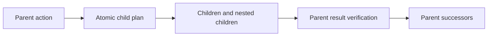

# Runtime children

Return a child plan when a running step discovers work that must finish before
its successors can start. Children belong to the same workflow; they can return
child plans of their own. This API is available from `v2.0.0`.

## Public API

```php
Scarlett\Execution\Decision::children(
    array $nodes,
    mixed $result = null,
    ?string $resultFrom = null,
    string $state = Scarlett\States\Completed::class,
): self;
```

`$nodes` is a list of `Scarlett\Definition\Node` definitions. Return this decision
from `handle()`, `before(Context): ?Decision`, or
`onException(Throwable, Context): Decision`. Build definitions, never child step
instances. Scarlett restores inputs and constructs each child only when claimed.
Optional node `title`, `description` and `canonical` labels survive key
qualification. Each child gets its own reflected signature and argument snapshot;
these labels do not change identity, deduplication or result selection.
The runner recognizes this child directive returned by `handle()`; other handle
return values retain their existing result semantics.

The decision ends the parent's action. Scarlett atomically validates and stores
the complete plan, persists the handoff, moves the parent to `waitingforchildren`,
and records eligible child delivery intents. Publication occurs after commit.
No caller-owned block UUID, deduplication column, retry loop or scheduler is needed.

When all children succeed, Scarlett queues **parent verification**, using its
original constructor inputs and effective result. It does not run the parent's
`before()`, throttle policy or `handle()` again. Verification retries and lease
recovery use its existing separate verification budget. Only successful
verification completes the parent and releases its successors.



## Backup result

A backup remains a separate step, with its own execution settings, retries,
telemetry and failure handling. Your application selects the backup policy.
`onException()` also receives a deadlock, serialization conflict or dropped connection
raised while Scarlett records a plan from `handle()`; retry those instead of treating
them as a failed candidate.

```php
public function onException(Throwable $exception, Context $context): Decision
{
    $next = $this->nextCandidate($exception); // Consumer-owned selection.

    if ($next === null) {
        return Decision::fail('No candidate succeeded.');
    }

    return Decision::children([
        new Node('backup', static::class, inputs: [
            'requestId' => $this->requestId,
            'candidate' => $next,
        ]),
    ], resultFrom: 'backup');
}
```

`resultFrom` names a **direct ordinary child** in this plan. After the whole child
subtree succeeds, its persisted payload becomes the parent's result. The parent's
own `$result` argument is unused when `resultFrom` is supplied. Typed payloads and
`null` are preserved. Nested backups forward their effective result through each
waiting parent, so later `FromResult('original-step')` bindings keep working.
No application code needs to copy results between step records.

A selected child that skips without producing a result fails its parent with
`FailureCause::ChildResultMissing` and a diagnostic reason. A failed or stopped
child follows the existing `FailureCause::ChildFailed` path instead. Cancellation
remains cancellation. Failure hooks keep their child-before-parent ordering.

## Data-dependent fanout

```php
public function handle(): Decision
{
    $children = [];

    foreach ($this->mentions() as $mention) {
        $children[] = new Node(
            'mention-'.$mention->id,
            MatchMention::class,
            inputs: ['mentionId' => $mention->id],
        );
    }

    $children[] = new Node('finish', FinishMatching::class, stage: 1);

    return Decision::children($children, result: ['scheduled' => count($children)]);
}
```

Same-stage siblings run in parallel; later stages wait for every earlier sibling.
Use `parent` for a nested predefined subtree and `rescues` for recovery branches
inside the plan. Failure cascades drain descendant rescue branches before failing
the parent and admitting its own rescue. An empty plan is valid: Scarlett goes
straight to parent verification with `$result`.

## Guarantees and limits

- **Cooldown:** started workflows can create and finish runtime descendants even
  after cooldown begins. Parent verification continues without reopening;
  unrelated new workflows remain held. These are steps in the same workflow,
  not independently owned child workflows.
- **Ownership:** the workflow lock and current unexpired attempt guard the write.
  Stale, cancelled and expired attempts cannot admit children. Subject deletion
  uses that same workflow lock; expansion acquires no new global admission lock.
- **One plan per action:** retries before a committed handoff may build a new plan.
  A committed handoff cannot be duplicated by redelivery, recovery or a competing
  caller. A crash before commit rolls back the plan; after commit, its durable
  delivery intents recover normally. External effects still require idempotency.
- **Closed graph:** no incremental appending, reopening settled work, or mixing a
  runtime plan with predefined ordinary children on the same parent. Predefined
  rescue nodes on that parent are allowed. Each runtime child may hand off its own
  plan if it has no predefined ordinary children. Fixed trees can stay predefined.
- **Local keys:** node keys, `parent`, `rescues`, `resultFrom` and `FromResult` refer
  only to this plan. Scarlett namespaces stored keys by the owner's step UUID.
  Local keys may contain at most 218 UTF-8 characters (255 minus the UUID prefix
  and separator). Do not parse stored keys to establish business relationships.
- **Local dependencies:** `FromResult` can read earlier siblings or a declared
  local parent/rescue target, as in a static workflow. Pass already resolved
  predecessor values as literal child inputs; referencing an existing workflow
  node from this plan is rejected. This also prevents circular reads of the
  result the waiting owner expects from its child.
- **Routing:** omitted queue, connection and priority inherit from the nearest
  local parent/rescue target, then the running owner. Explicit overrides win,
  including priority `0`. `Node::$priority` and its constructor parameter now
  accept `null` for inheritance; ordinary workflow admission still resolves it
  to `0`. Execution options remain the child's class defaults or node override,
  snapshotted at admission. `notBefore` retains its normal scheduling semantics.
- **Hooks:** no child handoff during verification, terminal failure hooks or input
  restoration failure. The step must have been constructed and its action must
  not already be persisted. `$state` must be registered, successful, non-skipping,
  and reachable from both Running and WaitingForChildren.
  A plan the engine rejects ends the parent as `ResultPersistence` when returned from
  `handle()` or `before()`, and as `HandlerCrashed` when returned from `onException()`.
  A passing database error while handing off a `handle()` or `before()` plan is not a
  rejection: `onException()` classifies it, so the parent can retry. Only database
  exceptions count; a rejection whose text mentions a deadlock still ends the parent.

## Upgrade and rollback

Run ordinary `php artisan migrate` after updating the package. The additive
`2026_11_14_000007_add_runtime_children.php` migration adds nullable handoff fields;
existing graphs retain their behavior. Deploy coordinated worker code: old workers
cannot process the new verification handoff. Stop/drain workers before changing
code, migrate, then restart workers on the new revision.

Rollback refuses to remove these fields while an unfinished workflow contains a
runtime plan. Drain those workflows, stop workers, then roll back schema and code
together. Settled results remain intact. Never edit or copy published migrations.

## Upgrade from Scarlett 1.x

1. Change the Composer constraint to `^2.0` and resolve the new version through your
   normal dependency workflow. Existing `^1.0` constraints will not select this release.
2. Review direct reads of `Node::$priority`: its type/default is now `?int = null`.
   Omission inherits routing in runtime plans and resolves to zero for ordinary
   workflow admission. Use explicit `priority: 0` to override inherited priority.
3. Resolve `Engine` through Laravel's container or the facade. Its constructor
   dependencies changed; custom manual construction must follow the new signature.
4. Add `FailureCause::ChildResultMissing` to exhaustive enum matches. It means the
   selected child settled without a durable result, such as a skipped backup.
5. Pause admission and drain/stop old workers, update the package, run ordinary
   `php artisan migrate`, then start the updated workers. Migration `000007` adds
   nullable fields; existing predefined workflows need no data conversion.

Existing predefined child timing remains unchanged. Runtime plans verify their
parent after the children settle. Do not mix package versions among active workers.
For rollback, drain runtime work and stop workers before downgrading schema/code;
the new migration refuses rollback while an unfinished workflow uses its fields.
