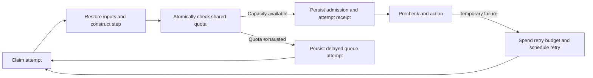

# Throttling and retries

A throttle controls **admission before a step's action**. A retry handles **an
unsuccessful action**. Scarlett keeps the counters, timing and responsibilities
separate. The reusable `RateLimit` policy is available from v2.1.0.

## Configure named quotas

Add policies to your application's `config/scarlett.php`:

```php
// Twenty admissions in any rolling sixty-second window; bursts are permitted.
'throttles' => [
    'ai-primary' => ['max_requests' => 20, 'per_seconds' => 60],
    'ai-backup' => ['max_requests' => 1, 'per_seconds' => 10],
    'slow-service' => ['max_requests' => 1, 'per_seconds' => 60],
],
```

Both settings must be positive integers, and `per_seconds` must fit the
millisecond timestamp storage range at validation time. A missing or malformed
policy throws; it never silently becomes unlimited. Policy names are exact,
including case, and must be valid UTF-8. `RateLimit` refuses a name or sharing key
that is not valid UTF-8 when the policy is constructed.
The empty package configuration imposes no limit on existing steps.

A quota of 20 per 60 seconds permits an initial burst of 20. Use one admission
per interval when you want spacing. Limits are not simultaneous-call caps, exact
execution schedules or first-in-first-out guarantees.

## Attach a policy to a step

In your existing step, return a policy from the standard hook:

```php
use Scarlett\Policies\RateLimit;
use Scarlett\Policies\Throttle;

public function throttle(): ?Throttle
{
    return new RateLimit('ai-primary', key: $this->accountId);
}
```

`$this->accountId` is an ordinary constructor input owned by your step. Use a
non-secret, non-empty identifier. Only a hash of the policy name and sharing key
is stored in the quota table.

| Sharing choice | Behavior |
| --- | --- |
| Same policy name and same key | One allowance shared across step classes and workflows |
| Same policy, different account keys | Independent allowances |
| Different policy names, same key | Independent allowances with their respective settings |
| Workflow ID as the key | An independent allowance per workflow |

All participants must use the same Scarlett database. For five independent
workflows, pass each workflow's ID as its key; the constructor-injected execution
Context exposes `workflowId`. For a provider account's actual quota, share the
account key across workflows instead. You can put the hook in a common application
step base class; no workflow-level attachment or automatic child inheritance is
introduced. Existing custom `Throttle` implementations still work unchanged.

## What happens before the call



The database transaction locks workflow, step and then quota. It checks current
attempt ownership, rejects an expired lease after waiting for the quota lock, and
commits the grant with the step receipt. Simultaneous workflows cannot both take
the last allowance. Repeating the same current attempt's check uses its receipt
without charging again, even if expired quota rows have since been pruned.

A denied check returns the whole seconds until capacity next expires, rounded up.
Scarlett requeues the step and releases the worker. On the next attempt it checks
again; another worker may have acquired the available capacity first. Waiting does
not increment failure or verification counters. Ordinary dependency ordering,
parent/child barriers, cancellation and recovery remain in force.

The policy is evaluated **after construction and before `before()`/`handle()`**.
Make the external call in the action, not in the constructor or input resolver.
One admitted action may make one intended API call; Scarlett does not intercept
HTTP clients or count multiple calls hidden inside a single action. Separate steps
are needed if each call needs its own admission. Saved-result verification and
terminal failure handlers do not acquire this action quota.

## Retry an unsuccessful API call

Use the existing exception hook to classify provider errors and return a retry:

```php
// Inside your onException handler; derive this delay from the provider response.
return Decision::retry(seconds: 30);
```

This consumes the existing failure budget. When the retry is due, it must also
pass the throttle. If a request failed at time zero, its retry delay is five
seconds, and the quota allows one admission per minute, the attempt at five
seconds waits another 55 seconds without spending another retry. The next actual
call can start no earlier than the quota permits.

Scarlett does not parse provider responses or `Retry-After`; the consumer's error
classifier supplies the delay. A retry delays that step only; it does not change
the named quota or impose a provider-wide cooldown on other workflows.
An explicit `Decision::throttle()` or `Throttled`
exception retains its existing **budget-free** deferral meaning. Do not use that
path when you intend an error to count toward bounded retries.

`Throttled` accepts optional `code` and `previous` arguments, as `RuntimeException` does.

An admission is charged when permission is granted, not when the API succeeds.
There is no refund after a skip, cancellation, failure or worker crash: Scarlett
cannot know whether the remote service received the call. A recovered attempt is
a new attempt and must obtain fresh permission. A crash cannot reset the quota.
These are admission guarantees, not exactly-once remote effects or proof of the
exact instant a remote request starts. Keep provider-side effects idempotent.

## Database lifecycle and configuration changes

Consumers install the additive `2026_11_14_000009_add_throttle_reservations.php`
migration through ordinary `php artisan migrate` before using the policy. It adds:

- `scarlett_throttles`: hashed identity, admitted timestamps, policy settings and
  indexed expiry, stored as UTC epoch milliseconds.
- `scarlett_steps.throttle_reservations`: nullable receipt for the latest admitted
  attempt; removed naturally with the step's retained history.

No existing migration is edited, no provider credentials are stored in the new
table, and no Redis service or extra Composer dependency is required. Workers
must have synchronized clocks. A busy quota stores at most its configured number
of admissions; one database row remains per distinct sharing identity.

To remove expired identities, schedule the optional command in your application:

```sh
php artisan scarlett:prune-throttles --batch=100
```

The batch option controls fetch size, not the total cleanup count. The command
rechecks expiry when deleting, so a concurrently renewed quota is retained.
There is no package-owned schedule. Archiving/deleting one workflow does not reset
an account quota shared by others.

All workers using a named key must agree on its limits. Conflicting settings
against an active window raise an error without changing the quota. Pause affected
admissions, let the old window expire, update configuration and restart the relevant
workers before resuming. Once expired, the next admission adopts the new settings.
Use the same name/key when changing limits; a new name/key creates an independent
allowance and therefore does not carry old usage forward.

For rollback, stop relevant workers first and allow active windows to expire.
The migration refuses rollback while an unexpired quota remains. Rollback removes
only the new quota bookkeeping, preserving existing workflow data. Fresh install,
retained-data upgrade, repeated installation and rollback are covered in package
tests on each supported database.

## Public API

- `new Scarlett\Policies\RateLimit(string $name, string $key)` selects configured
  limits and exact sharing identity.
- `RateLimit::delay(Scarlett\Execution\Context $context): ?int` is called through
  the existing throttle hook. It returns null or a positive wait and requires a
  current action attempt; stale contexts and failure-handler contexts cannot reserve.
- `RateLimit::id(): string` exposes the hashed quota identity for diagnostics.
- `scarlett:prune-throttles {--batch=}` removes expired identities; default batch
  size is 100. Invalid batch options return a nonzero exit status.

One policy per step remains the public hook contract. Composite quotas, explicit
concurrency permits and automatic workflow-level assignment are not included.
